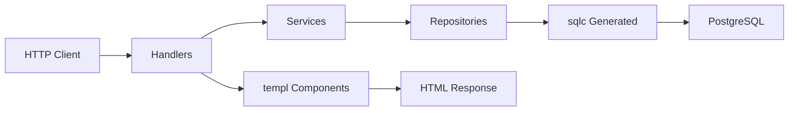

# Requirements

### Overview
Migrate the Halisi gas delivery application from its current stack (SQLite + handwritten SQL + html/template) to a modern stack (PostgreSQL + sqlc + templ) in four phases, preserving all existing functionality and business logic.

### Current Stack
- **Database:** SQLite (`github.com/mattn/go-sqlite3`)
- **Database access:** Handwritten SQL with `?` placeholders in `internal/repository/`
- **Frontend:** 14 HTML templates rendered with `html/template`
- **Backend:** Go stdlib `net/http` with Handlers → Services → Repositories pattern

### Target Stack
- **Database:** PostgreSQL
- **Database access:** sqlc (type-safe, compiled SQL)
- **Frontend:** templ (type-safe server-side components)
- **Backend:** Go stdlib `net/http` — **unchanged**

### What stays the same
- Handlers, services, and business logic are retained wherever possible
- Repository method signatures stay the same (services don't change)
- CSS and JavaScript static assets are preserved
- Google OAuth authentication flow is unchanged
- Session management with `gorilla/sessions` is unchanged
- Role-based access control (customer/owner/admin) is unchanged

### Phases
1. **SQLite → PostgreSQL** — database engine and schema migration
2. **Handwritten SQL → sqlc** — type-safe query generation
3. **html/template → templ** — type-safe server-side rendering
4. **Integration testing** — end-to-end verification of all features

### Out of Scope
- Changing the HTTP routing approach (staying with stdlib)
- Adding a new ORM (sqlc is not an ORM)
- Modifying the UI design or CSS
- Changing the authentication mechanism

# Technical Design

### Current Implementation

**Database layer** (`internal/database/database.go`):
- Uses `github.com/mattn/go-sqlite3` with CGO
- 4 tables: `users`, `shops`, `orders`, `kyc_documents`
- SQLite-specific column migration via `pragma_table_info()`
- Global `DB *sql.DB` variable shared across repositories

**Repositories** (`internal/repository/`):
- `user_repository.go` — 306 lines, uses `?` placeholders, owns a `*sql.DB` field
- `order_repository.go` — 288 lines, uses global `database.DB`, includes JOIN queries
- `shop_repository.go` — 336 lines, uses global `database.DB`
- `kyc_document_repository.go` — 238 lines, owns a `*sql.DB` field
- `repository_test.go` — 588 lines, uses `:memory:` SQLite

**Services** (`internal/services/`):
- `services.go` — `UserService` with registration, login, Google auth logic
- `order_service.go` — thin wrapper around `OrderRepository`
- `kyc_document_service.go` — validation + repo calls

**Handlers** (`internal/handlers/`):
- `handlers.go` — 1140 lines, uses `template.ParseFiles()` to render HTML
- `google_auth.go` — Google OAuth flow
- `kyc_document_handler.go` — KYC-specific HTTP handlers
- `renderTemplate()` helper parses `.html` files at request time

**Templates** (`web/templates/`):
- 14 HTML files: `index.html`, `login.html`, `register.html`, `dashboard.html` (900 lines), `shops.html`, `shop.html`, `order.html`, `orders.html`, `order_confirmation.html`, `admin.html`, `shop_manage.html`, `shop_orders.html`, `navbar.html`, `vendor_navbar.html`

### Key Decisions

1. **PostgreSQL driver:** `github.com/lib/pq` — pure Go PostgreSQL driver, widely used, no CGO required (eliminates the CGO dependency that SQLite required).

2. **sqlc over ORM:** sqlc generates type-safe Go code from SQL — we keep full control of queries while getting compile-time safety. No GORM or ent.

3. **templ over html/template:** templ provides type-safe components with Go-level type checking for template data, eliminating runtime template errors.

4. **Repository signatures preserved:** All repository method signatures remain unchanged so services and handlers don't need modification during Phases 1-2.

5. **Dependency injection for `*sql.DB`:** Move from global `database.DB` to passing `*sql.DB` through constructors — required for sqlc integration and cleaner testing.

6. **Phased approach:** Each phase is independently testable. Handlers and services are never touched in Phase 1 and 2. Database and repositories are never touched in Phase 3.

### Proposed Changes

#### Phase 1: SQLite → PostgreSQL
- Replace `go-sqlite3` with `lib/pq` in `go.mod`
- Rewrite `database.go` for PostgreSQL connection and schema
- Convert schema: `AUTOINCREMENT` → `SERIAL`, `INTEGER` bool → `BOOLEAN`, `DATETIME` → `TIMESTAMP`
- Remove `pragma_table_info` migration logic
- Update `Dockerfile` (remove SQLite CGO deps)
- Update tests to use PostgreSQL

#### Phase 2: Handwritten SQL → sqlc
- Add `sqlc.yaml` config
- Create `internal/database/queries/` with `.sql` files per entity
- Convert `?` to `$1, $2, ...` PostgreSQL params
- Generate Go code to `internal/database/queried/`
- Refactor repositories to call generated sqlc methods
- Keep repository interfaces identical

#### Phase 3: html/template → templ
- Create `.templ` files in `web/templ/`
- Convert 14 templates to typed components
- Replace `renderTemplate()` with templ component calls
- Run `templ generate`
- Preserve all CSS/JS

#### Phase 4: Integration
- Full E2E test of all features
- Clean up old files
- Final `Dockerfile` update

### File Structure

```
halisi/
├── cmd/api/main.go              # modified: DI for *sql.DB, sqlc wiring
├── internal/
│   ├── database/
│   │   ├── database.go          # rewritten: PostgreSQL
│   │   ├── queries/             # NEW: sql query files
│   │   │   ├── user_queries.sql
│   │   │   ├── shop_queries.sql
│   │   │   ├── order_queries.sql
│   │   │   └── kyc_queries.sql
│   │   └── queried/             # NEW: sqlc generated code
│   ├── handlers/                # modified Phase 3: templ rendering
│   ├── middleware/              # unchanged
│   ├── models/                  # unchanged
│   ├── repository/              # rewritten Phase 2: sqlc calls
│   └── services/                # unchanged
├── web/
│   ├── templ/                   # NEW: templ components
│   │   ├── index.templ
│   │   ├── login.templ
│   │   ├── register.templ
│   │   ├── dashboard.templ
│   │   ├── shops.templ
│   │   ├── shop.templ
│   │   ├── order.templ
│   │   ├── orders.templ
│   │   ├── order_confirmation.templ
│   │   ├── admin.templ
│   │   ├── shop_manage.templ
│   │   ├── shop_orders.templ
│   │   ├── navbar.templ
│   │   └── vendor_navbar.templ
│   ├── templates/               # REMOVED after Phase 3
│   └── static/                  # unchanged
├── sqlc.yaml                    # NEW
├── Dockerfile                   # modified
└── go.mod                       # modified
```

### Architecture Diagram



### Risks
- **PostgreSQL bool mapping:** SQLite stores bool as `INTEGER` (0/1). PostgreSQL `BOOLEAN` needs proper scanning in Go. Models use `bool` type — sqlc will handle this correctly.
- **LastInsertId:** PostgreSQL uses `RETURNING` clause instead of `LastInsertId()`. sqlc generates this automatically.
- **Template conversion:** `dashboard.html` is 900+ lines — largest conversion effort. Range loops and conditionals need careful translation to templ syntax.
- **Test infrastructure:** Moving from `:memory:` SQLite to PostgreSQL for tests requires either a test container or a local PostgreSQL instance.

# Testing

### Validation Approach
Each phase is validated independently before proceeding to the next. The application must compile and all existing functionality must work after each phase.

### Phase 1 Validation
- Application starts and connects to PostgreSQL
- All 4 tables are created with correct PostgreSQL types
- Repository CRUD operations work against PostgreSQL
- `repository_test.go` passes with PostgreSQL

### Phase 2 Validation
- `sqlc generate` produces code without errors
- All repository methods still return correct results
- JOIN queries (orders with shop/user names) still work
- `repository_test.go` passes with sqlc-generated code

### Phase 3 Validation
- `templ generate` produces code without errors
- All 14 pages render correctly in the browser
- Dynamic data (user names, shop lists, order details) renders correctly
- Navbar components render correctly for all roles
- CSS and JS still load and function

### Phase 4 Validation — End-to-End Scenarios
- **Google auth:** login via Google → session created → redirect to dashboard
- **Customer flow:** register → login → browse shops → place order → view orders
- **Shop owner flow:** register as owner → create shop → upload KYC → manage prices → update order status
- **Admin flow:** view pending KYC → approve/reject documents → verify shops
- **Persistence:** restart app → data survives in PostgreSQL
- **Role isolation:** customer can't access admin routes, owner can't access admin routes

### Edge Cases
- Email verification with unverified users re-registering
- KYC rejection with reason messages
- Order status transitions (Pending → Confirmed → Delivered)
- Empty states (no shops, no orders, no pending KYC)

# Delivery Steps

### ✓ Step 1: Phase 1: Migrate SQLite to PostgreSQL
Replace SQLite database with PostgreSQL and adapt the schema.

- Replace `github.com/mattn/go-sqlite3` dependency with `github.com/lib/pq` (PostgreSQL driver) in `go.mod`.
- Rewrite `internal/database/database.go`: connect to PostgreSQL using `DATABASE_URL` env var, replace SQLite DDL with PostgreSQL `CREATE TABLE IF NOT EXISTS` statements, remove SQLite-specific `pragma_table_info` column migration logic (PostgreSQL supports `ALTER TABLE ... ADD COLUMN IF NOT EXISTS`).
- Adapt schema types: `INTEGER PRIMARY KEY AUTOINCREMENT` → `SERIAL PRIMARY KEY`, `BOOLEAN` stored as `BOOLEAN` (not `INTEGER`), `DATETIME` → `TIMESTAMP`, `REAL` → `DOUBLE PRECISION`.
- Update `cmd/api/main.go` to pass `*sql.DB` to repositories instead of relying on the global `database.DB` (cleaner dependency injection for sqlc later).
- Update `Dockerfile` to remove SQLite build deps and add PostgreSQL client libs if needed.
- Update `internal/repository/repository_test.go` to use a test PostgreSQL container or `testcontainers-go` instead of `:memory:` SQLite.
- Test: verify all repository CRUD operations work against PostgreSQL.

### ✓ Step 2: Phase 2: Migrate handwritten SQL to sqlc
Replace inline SQL queries in repositories with sqlc-generated type-safe code.

- Install sqlc CLI and create `sqlc.yaml` at project root with PostgreSQL dialect, query directory, and generated Go package output.
- Create `internal/database/queries/` directory with SQL files:
  - `user_queries.sql` — all user INSERT/SELECT/UPDATE queries (currently in `user_repository.go`).
  - `shop_queries.sql` — all shop queries (currently in `shop_repository.go`).
  - `order_queries.sql` — all order queries including JOINs (currently in `order_repository.go`).
  - `kyc_queries.sql` — all KYC document queries (currently in `kyc_document_repository.go`).
- Convert `?` placeholders to `$1, $2, ...` PostgreSQL positional parameters.
- Define SQL queries with `-- name: ...` comments for function generation.
- Run `sqlc generate` to produce Go code in `internal/database/queried/`.
- Refactor `internal/repository/` files: replace manual `db.Exec`/`db.QueryRow`/`db.Query` calls with calls to the generated sqlc queries object.
- Keep repository struct names and method signatures the same so services and handlers require no changes.
- Update `cmd/api/main.go` to wire the generated sqlc DB layer into repositories.
- Update `internal/repository/repository_test.go` to work with the new sqlc-generated code.
- Test: verify all repository operations still pass.

### * Step 3: Phase 3: Migrate html/template to templ
Convert 14 HTML templates to templ components for type-safe server-side rendering.

- Install templ CLI.
- Create `web/templ/` directory for `.templ` files.
- Convert templates to `.templ` components:
  - `navbar.templ` and `vendor_navbar.templ` — shared navbar components (extracted from `navbar.html` and `vendor_navbar.html`).
  - `index.templ` — home page (from `index.html`).
  - `login.templ` — login page (from `login.html`).
  - `register.templ` — registration page (from `register.html`).
  - `dashboard.templ` — customer dashboard (from `dashboard.html`, ~900 lines, largest template).
  - `shops.templ` — shops listing (from `shops.html`).
  - `shop.templ` — single shop detail (from `shop.html`).
  - `order.templ` — order placement (from `order.html`).
  - `orders.templ` — order history (from `orders.html`).
  - `order_confirmation.templ` — order confirmation (from `order_confirmation.html`).
  - `admin.templ` — admin dashboard (from `admin.html`).
  - `shop_manage.templ` — shop owner management (from `shop_manage.html`).
  - `shop_orders.templ` — shop owner orders view (from `shop_orders.html`).
- Run `templ generate` to produce `.go` files.
- Update `internal/handlers/handlers.go`: replace `renderTemplate()` helper (which used `template.ParseFiles`) with calls to the generated templ components.
- Preserve all existing CSS (`web/static/css/style.css`, `home.css`) and JS (`web/static/js/app.js`) — no changes to static assets.
- Test: verify every page renders correctly in the browser.

###   Step 4: Phase 4: Integration testing and verification
End-to-end verification of the entire migrated application.

- Start the application with PostgreSQL backend, sqlc data layer, and templ frontend.
- Test Google authentication flow (`/auth/google` → `/auth/google/callback`).
- Test customer registration and login (`/register`, `/login`).
- Test shop owner registration and shop creation.
- Test KYC document submission (`/shop/kyc/upload`) and admin review (`/admin/kyc/review`).
- Test admin verification of shops (`/admin/verify-shop`).
- Test verified shop listings visible to customers (`/shops`).
- Test order placement and delivery status updates (`/order`, `/orders/update`).
- Test role-based dashboards: customer (`/dashboard`), admin (`/admin`), owner (`/shop/manage`).
- Verify PostgreSQL persistence: restart the app and confirm data survives.
- Run `internal/repository/repository_test.go` against PostgreSQL.
- Final cleanup: remove old `.html` template files, verify `go.mod` has no unused deps, update `Dockerfile` for the final stack.