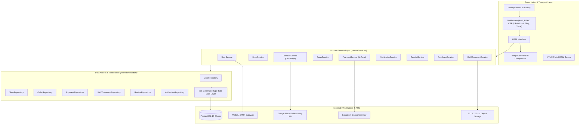
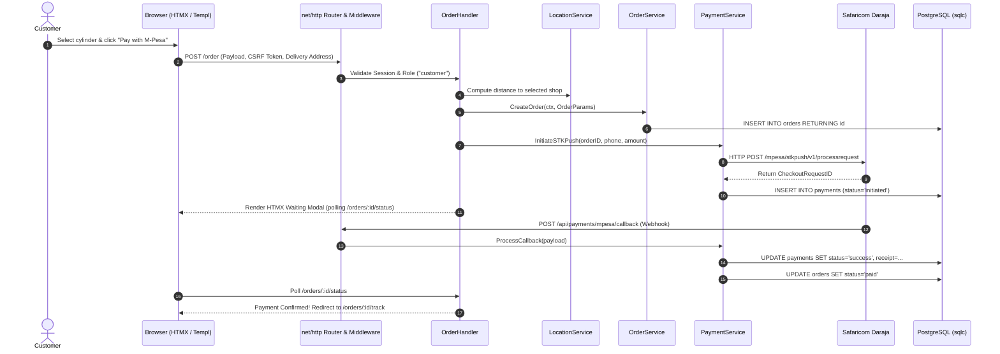

# Halisi System Architecture Specification

## 1. Architectural Overview

**Halisi** is an on-demand liquefied petroleum gas (LPG) marketplace and delivery tracking platform engineered for high reliability, fast local proximity queries, and fault-tolerant mobile money payments.

The architecture follows **Clean / Layered Architecture** principles, enforcing a strict separation between transport interfaces, business use-case logic, data access abstractions, and external integrations.

---

## 2. Multi-Role RBAC Model

Halisi enforces a multi-tier Role-Based Access Control (RBAC) hierarchy embedded in signed session cookies:

| Role | Identifier | Permissions & Capabilities |
|---|---|---|
| **Customer** | `customer` | Browse nearby vendors, search via Google Maps, configure multi-cylinder refill orders, trigger M-Pesa STK push, receive in-app alerts, download digital receipts, review fulfilled orders. |
| **Shop Owner** | `owner` | Configure gas shop profile, toggle operating status (Open/Closed), manage inventory stock per cylinder size, upload regulatory KYC documentation, accept/dispatch orders, view sales ledger. |
| **Delivery Rider** | `rider` | View assigned orders, launch Google Maps turn-by-turn route to delivery address, confirm delivery via customer OTP PIN. |
| **Administrator** | `admin` | Inspect and verify vendor KYC documents (EPRA license, KRA PIN), issue verification badges, view platform-wide GMV, manage disputes and review moderation. |

---

## 3. Core Domain Services Specification

### 3.1. `LocationService` (Proximity & Google Maps)
* **Proximity Matching**: Implements the Haversine spherical formula in PostgreSQL to compute distance (in kilometers) between customer delivery coordinates `(lat_cust, lon_cust)` and vendor coordinates `(lat_shop, lon_shop)`.
* **Google Maps Integration**:
  * Client-side interactive map showing nearby gas shops with real-time availability badges.
  * Server-side Geocoding API helper resolving delivery address strings to precision GPS lat/long pairs.
  * Distance matrix calculation for delivery fee estimations.

### 3.2. `PaymentService` (M-Pesa Daraja Integration)
* **STK Push Generation**: Initiates Safaricom Daraja Lipa Na M-Pesa Online prompt directly to the customer's mobile device.
* **Webhook Ingestion**: Handles asynchronous callbacks at `/api/payments/mpesa/callback` with HMAC signature validation, replay mitigation, and idempotent state persistence.
* **Transaction Ledger**: Records every payment attempt, merchant request ID, checkout request ID, and Safaricom receipt number in an immutable `payments` ledger.

### 3.3. `NotificationService` (In-App & Alerts)
* **In-App Notification Center**: Persists real-time notifications for users (e.g. "Order Confirmed", "Rider Dispatched", "KYC Approved").
* **Polling & Streaming**: Exposes HTMX polling and Server-Sent Events (SSE) for zero-refresh notification counters and toast popups.

### 3.4. `ReceiptService` (Digital Receipts)
* **Receipt Generation**: Formats and signs digital purchase receipts upon successful order completion.
* **Receipt Verification**: Embeds a unique verification hash and QR code linking back to `/verify-receipt?hash=...` for tamper detection and tax auditing.

### 3.5. `FeedbackService` (Ratings & Reviews)
* **Verified Purchaser Constraint**: Only users with an order in `delivered` state can submit a rating (1-5 stars) and review text.
* **Aggregated Scoring**: Automatically computes weighted average shop ratings and badges (e.g. "Top Rated Vendor", "Fast Delivery").

---

## 4. Request Lifecycle & Data Flow

---

## 5. Security & Reliability Architecture

1. **CSRF Protection**: All state-changing POST/PUT requests validate cryptographically signed double-submit tokens.
2. **Rate Limiting**: Sliding window rate-limiting middleware guards auth and payment endpoints from brute-force attempts.
3. **Structured Telemetry**: Context-aware `log/slog` handlers tag every log entry with `request_id`, `user_id`, and execution duration.
4. **Relational Integrity**: Foreign key constraints and transaction isolation levels guarantee zero orphan records or corrupted financial states.
