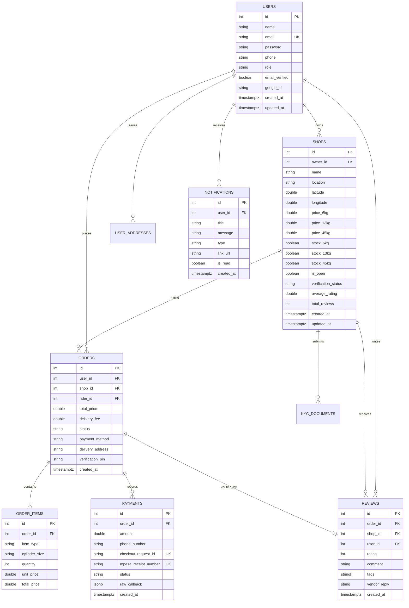

# Halisi Database Architecture & Schema Specification

## 1. Overview & Engine Specification

* **Database Engine**: PostgreSQL 16+
* **Driver**: Pure Go `github.com/lib/pq` (no CGO dependency)
* **Query Engine**: `sqlc` (compile-time type-safe code generation)
* **Migration Tooling**: `golang-migrate` with versioned up/down SQL migrations
* **Character Set**: UTF-8 (`en_US.UTF-8`)
* **Timezone**: UTC (`TIMESTAMPTZ` used universally)

---

## 2. Entity-Relationship Diagram



---

## 3. Database Schema Definitions

### 3.1. `users`
Represents consumers, gas shop owners, delivery riders, and administrators.

| Column | Type | Constraints | Description |
|---|---|---|---|
| `id` | `SERIAL` | `PRIMARY KEY` | Unique identifier |
| `name` | `TEXT` | `NOT NULL` | Full user name |
| `email` | `TEXT` | `NOT NULL UNIQUE` | Case-insensitive email |
| `phone` | `TEXT` | `DEFAULT ''` | Mobile number (`2547XXXXXXXX`) |
| `password` | `TEXT` | `NOT NULL` | bcrypt-hashed password hash |
| `role` | `TEXT` | `CHECK (role IN ('customer', 'owner', 'rider', 'admin'))` | RBAC role |
| `email_verified` | `BOOLEAN` | `NOT NULL DEFAULT FALSE` | Email confirmation state |
| `verification_token` | `TEXT` | `DEFAULT ''` | Cryptographic email token |
| `google_id` | `TEXT` | `NOT NULL DEFAULT ''` | Google OpenID sub identifier |
| `created_at` | `TIMESTAMPTZ` | `DEFAULT CURRENT_TIMESTAMP` | Account creation timestamp |
| `updated_at` | `TIMESTAMPTZ` | `DEFAULT CURRENT_TIMESTAMP` | Last updated timestamp |

### 3.2. `shops`
Certified LPG retail outlets and refill depots.

| Column | Type | Constraints | Description |
|---|---|---|---|
| `id` | `SERIAL` | `PRIMARY KEY` | Unique shop ID |
| `owner_id` | `INTEGER` | `REFERENCES users(id) ON DELETE CASCADE` | Vendor user ID |
| `name` | `TEXT` | `NOT NULL` | Business / brand name |
| `location` | `TEXT` | `NOT NULL` | Street or estate description |
| `phone` | `TEXT` | `NOT NULL` | Storefront dispatch phone |
| `latitude` | `DOUBLE PRECISION` | `DEFAULT 0` | GPS coordinate for maps |
| `longitude` | `DOUBLE PRECISION` | `DEFAULT 0` | GPS coordinate for maps |
| `price_6kg` | `DOUBLE PRECISION` | `NOT NULL DEFAULT 0` | Refill price for 6kg |
| `price_13kg` | `DOUBLE PRECISION` | `NOT NULL DEFAULT 0` | Refill price for 13kg |
| `price_45kg` | `DOUBLE PRECISION` | `NOT NULL DEFAULT 0` | Refill price for 45kg |
| `stock_6kg` | `BOOLEAN` | `DEFAULT TRUE` | Real-time stock toggle |
| `stock_13kg` | `BOOLEAN` | `DEFAULT TRUE` | Real-time stock toggle |
| `stock_45kg` | `BOOLEAN` | `DEFAULT TRUE` | Real-time stock toggle |
| `is_open` | `BOOLEAN` | `DEFAULT TRUE` | Store operating state |
| `business_registration_number` | `TEXT` | `DEFAULT ''` | Regulatory registry code |
| `kra_pin` | `TEXT` | `DEFAULT ''` | Tax ID number |
| `license_number` | `TEXT` | `DEFAULT ''` | EPRA petroleum retail license |
| `verification_status` | `TEXT` | `CHECK (verification_status IN ('pending', 'verified', 'rejected'))` | Admin review state |
| `average_rating` | `NUMERIC(3,2)` | `DEFAULT 0.00` | Cached average star score |
| `total_reviews` | `INTEGER` | `DEFAULT 0` | Count of customer reviews |
| `created_at` | `TIMESTAMPTZ` | `DEFAULT CURRENT_TIMESTAMP` | Shop onboarding timestamp |
| `updated_at` | `TIMESTAMPTZ` | `DEFAULT CURRENT_TIMESTAMP` | Last updated timestamp |

### 3.3. `orders`
Refill and accessory orders placed by customers.

| Column | Type | Constraints | Description |
|---|---|---|---|
| `id` | `SERIAL` | `PRIMARY KEY` | Order ID |
| `user_id` | `INTEGER` | `REFERENCES users(id) ON DELETE RESTRICT` | Buyer user ID |
| `shop_id` | `INTEGER` | `REFERENCES shops(id) ON DELETE RESTRICT` | Fulfillment vendor ID |
| `rider_id` | `INTEGER` | `REFERENCES users(id) ON DELETE SET NULL` | Assigned courier |
| `total_price` | `DOUBLE PRECISION` | `NOT NULL` | Order total in KES |
| `delivery_fee` | `DOUBLE PRECISION` | `NOT NULL DEFAULT 0` | Itemized delivery cost |
| `status` | `TEXT` | `CHECK (status IN ('pending', 'paid', 'confirmed', 'out_for_delivery', 'delivered', 'cancelled'))` | Lifecycle state |
| `payment_method` | `TEXT` | `CHECK (payment_method IN ('mpesa', 'cash'))` | Chosen payment type |
| `delivery_address` | `TEXT` | `NOT NULL` | Customer address string |
| `delivery_latitude` | `DOUBLE PRECISION` | `DEFAULT 0` | Precision delivery coordinates |
| `delivery_longitude` | `DOUBLE PRECISION` | `DEFAULT 0` | Precision delivery coordinates |
| `verification_pin` | `TEXT` | `DEFAULT ''` | 4-digit OTP for rider drop-off |
| `created_at` | `TIMESTAMPTZ` | `DEFAULT CURRENT_TIMESTAMP` | Order timestamp |
| `updated_at` | `TIMESTAMPTZ` | `DEFAULT CURRENT_TIMESTAMP` | Status change timestamp |

### 3.4. `order_items`
Individual items and cylinder refill lines within an order.

| Column | Type | Constraints | Description |
|---|---|---|---|
| `id` | `SERIAL` | `PRIMARY KEY` | Item ID |
| `order_id` | `INTEGER` | `REFERENCES orders(id) ON DELETE CASCADE` | Parent order |
| `item_type` | `TEXT` | `CHECK (item_type IN ('cylinder', 'accessory'))` | Item category |
| `cylinder_size` | `TEXT` | `DEFAULT ''` | `6kg`, `13kg`, or `45kg` |
| `quantity` | `INTEGER` | `NOT NULL CHECK (quantity > 0)` | Quantity ordered |
| `unit_price` | `DOUBLE PRECISION` | `NOT NULL` | Unit cost |
| `total_price` | `DOUBLE PRECISION` | `NOT NULL` | `unit_price * quantity` |

### 3.5. `payments`
Immutable financial transaction ledger.

| Column | Type | Constraints | Description |
|---|---|---|---|
| `id` | `SERIAL` | `PRIMARY KEY` | Ledger entry ID |
| `order_id` | `INTEGER` | `REFERENCES orders(id) ON DELETE RESTRICT` | Associated order |
| `amount` | `NUMERIC(10,2)` | `NOT NULL` | Transacted amount (KES) |
| `phone_number` | `TEXT` | `NOT NULL` | Mobile money MSISDN |
| `merchant_request_id`| `TEXT` | `UNIQUE` | Daraja request ID |
| `checkout_request_id`| `TEXT` | `UNIQUE` | Daraja STK identifier |
| `mpesa_receipt_number`| `TEXT` | `UNIQUE` | Safaricom receipt code |
| `status` | `TEXT` | `CHECK (status IN ('initiated', 'success', 'failed', 'cancelled'))` | Payment status |
| `raw_callback` | `JSONB` | `DEFAULT '{}'` | Full Safaricom JSON webhook |
| `created_at` | `TIMESTAMPTZ` | `DEFAULT CURRENT_TIMESTAMP` | Initiation timestamp |

### 3.6. `reviews`
Verified buyer customer ratings and feedback tags.

| Column | Type | Constraints | Description |
|---|---|---|---|
| `id` | `SERIAL` | `PRIMARY KEY` | Review identifier |
| `order_id` | `INTEGER` | `UNIQUE REFERENCES orders(id) ON DELETE CASCADE`| Verified purchase link |
| `user_id` | `INTEGER` | `REFERENCES users(id) ON DELETE CASCADE` | Reviewer |
| `shop_id` | `INTEGER` | `REFERENCES shops(id) ON DELETE CASCADE` | Reviewed vendor |
| `rating` | `INTEGER` | `NOT NULL CHECK (rating >= 1 AND rating <= 5)` | 1-5 Star rating |
| `comment` | `TEXT` | `DEFAULT ''` | Written feedback |
| `tags` | `TEXT[]` | `DEFAULT '{}'` | E.g. `fast_delivery` |
| `vendor_reply` | `TEXT` | `DEFAULT ''` | Public owner reply |
| `created_at` | `TIMESTAMPTZ` | `DEFAULT CURRENT_TIMESTAMP` | Submission timestamp |

### 3.7. `notifications`
In-app real-time notification feed.

| Column | Type | Constraints | Description |
|---|---|---|---|
| `id` | `SERIAL` | `PRIMARY KEY` | Notification ID |
| `user_id` | `INTEGER` | `REFERENCES users(id) ON DELETE CASCADE` | Recipient |
| `title` | `TEXT` | `NOT NULL` | Short headline |
| `message` | `TEXT` | `NOT NULL` | Notification message |
| `type` | `TEXT` | `CHECK (type IN ('order', 'payment', 'kyc', 'system'))` | Alert classification |
| `link_url` | `TEXT` | `DEFAULT ''` | Action redirection URL |
| `is_read` | `BOOLEAN` | `DEFAULT FALSE` | Read receipt flag |
| `created_at` | `TIMESTAMPTZ` | `DEFAULT CURRENT_TIMESTAMP` | Alert timestamp |

---

## 4. Performance Indexes

```sql
-- Fast lookup of orders by customer & status
CREATE INDEX idx_orders_user_status ON orders(user_id, status);

-- Fast lookup of shop incoming orders
CREATE INDEX idx_orders_shop_status ON orders(shop_id, status);

-- Rider dispatch index
CREATE INDEX idx_orders_rider_status ON orders(rider_id, status);

-- Filter verified and active shops
CREATE INDEX idx_shops_status ON shops(verification_status, is_open);

-- Shop owner lookup
CREATE INDEX idx_shops_owner ON shops(owner_id);

-- Payment status lookups from Daraja webhooks
CREATE INDEX idx_payments_checkout_req ON payments(checkout_request_id);

-- Unread notification badge queries
CREATE INDEX idx_notifications_user_unread ON notifications(user_id, is_read);
```

---

## 5. Migration Management (`golang-migrate`)

Migrations reside in `internal/database/migrations/`:

The schema-normalization migration adds the user/shop/order audit timestamps,
their automatic `updated_at` triggers, and the requested foreign keys. It is
embedded in the application and applied during database initialization, so
existing databases are upgraded on startup. Fresh databases are created from
`internal/database/schema.sql`.

```bash
# Apply all pending up migrations
make migrate-up

# Roll back the latest migration
make migrate-down
```
