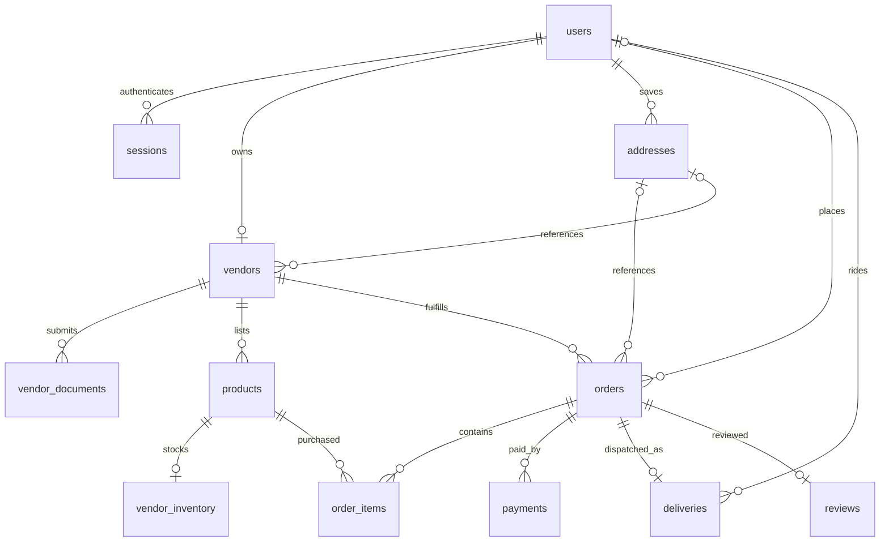

# Database migrations

HALISI uses golang-migrate v4 with its pgx/v5 driver. The version is pinned in
`go.mod`; `go mod download` installs the dependencies. The Go migration command
embeds SQL from `internal/database/migrations/`, so no global migrate CLI is
required and compiled binaries do not depend on the working directory.

## Configuration and commands

Set `DATABASE_URL` in the process environment using the database's actual
credentials. See `.env.example` for the URL format. `.env` is not automatically
loaded. The command uses `internal/config` and its validation; `PORT` and
`APP_ENV` retain their defaults. Use a database account allowed to create and
drop tables in the target schema. TLS and other connection options come from
the URL. Connection establishment defaults to a five-second timeout.

Run from the repository root:

```sh
go mod download
make migrate-up
make migrate-version
make migrate-down
```

Without Make (including PowerShell):

```sh
go run ./cmd/migrate up
go run ./cmd/migrate version
go run ./cmd/migrate down
```

`up` applies all pending versions. Repeating it succeeds without reapplying
existing migrations. `down` rolls back exactly one version and deletes the
tables/data removed by that version. Back up any data you need before rollback.
The HTTP server does not automatically apply migrations; run them explicitly
before deploying code that needs the schema.

## Initial schema

Version `000001` creates users, vendors, products, orders, order_items,
payments and deliveries. IDs are generated bigint identities. Foreign keys
preserve references; prices and stock cannot be negative and item quantities
and payment amounts must be positive. Monetary values use `NUMERIC(12,2)`.
The migration contains no accounts, credentials or seed data. Role/status
values and business workflows remain application responsibilities.

The up and down SQL each run in a transaction. Down removes tables in reverse
dependency order without CASCADE. The `schema_migrations` table records the
current version and dirty flag; it remains after rollback. Advisory locking
prevents concurrent migration execution. Do not edit a migration after it has
been applied: add a new numbered pair, e.g. `000005_description.up.sql` and
`000005_description.down.sql`.

On failure the command exits nonzero without printing driver errors that could
contain credentials. Check `migrate-version` and database logs. A dirty version
blocks further migrations: investigate and repair the failed migration before
using golang-migrate's administrative force command to reconcile the recorded
version. Force changes tracking only; it does not execute or undo SQL.

## Verification

```sh
go test ./...
go build ./...
```

Set `TEST_MIGRATION_DATABASE_URL` to a disposable PostgreSQL database to enable
the migration integration test. It creates and removes its own isolated schema,
verifies version tracking and repeat-up behavior, then tests rollback and reapply.
Without that variable the live migration test is skipped.

## Generate Go queries with sqlc

Use sqlc **v1.31.1** for reproducible output. Install the CLI with:

```sh
make sqlc-install
# Or without Make:
go install github.com/sqlc-dev/sqlc/cmd/sqlc@v1.31.1
```

Add the Go binary directory (`go env GOBIN`, or `go env GOPATH` plus `/bin` when
GOBIN is empty) to PATH. On Windows this is typically `%USERPROFILE%\go\bin`.
Confirm `sqlc version` prints `v1.31.1`.

`sqlc.yaml` configures PostgreSQL and `pgx/v5`. It reads schema migrations from
`internal/database/migrations/` and named SQL queries from
`internal/database/queries/`. sqlc understands the golang-migrate filename
convention and ignores down migrations. Generation needs no running database,
credentials, or `DATABASE_URL`.

After adding a migration or changing queries, run from the repository root:

```sh
make sqlc-generate
# Or without Make:
sqlc generate
go test ./...
go build ./...
```

Commit the SQL sources, `sqlc.yaml`, and generated files together. Go code in
`internal/database/sqlc/` is generated; change SQL and regenerate instead of
editing it by hand. To check reproducibility, regenerate and confirm there is
no diff in that directory.

Initial queries provide create, lookup by ID/email, paginated listing, profile
update and delete for users. Values use PostgreSQL `$1`, `$2`, etc. parameters.
Profile updates leave password hashes and roles unchanged. List results omit
password hashes. Lookup/create/update results are internal records that contain
password hashes: map them to response DTOs before exposing them via HTTP.
Delete returns the affected row count and obeys existing foreign keys.

Use the generated package with the application's pool:

```go
import dbsqlc "github.com/wanjiru-noreen/halisi/internal/database/sqlc"

queries := dbsqlc.New(pool)
user, err := queries.GetUser(ctx, userID)
```

The generated `DBTX` interface accepts a pgx pool, connection, or transaction;
`queries.WithTx(tx)` binds queries to a transaction. Missing single-row results
return `pgx.ErrNoRows`. Nullable columns use pgx types such as `pgtype.Text`.

## Core schema (version 000002)

Migration `000004` extends vendors/documents and adds audited reviews and selling
guards. See [vendor onboarding](VENDOR_ONBOARDING.md) for the current workflow,
fields, storage requirements and legacy-data upgrade behavior.

Version 2 extends the original tables without changing migration 1. All twelve
core tables have bigint identity primary keys (inventory uses `product_id` as
its primary key), `created_at` and `updated_at` as non-null `TIMESTAMPTZ` values.
Both timestamps default to the insertion time. A database trigger sets
`updated_at` on every update, including direct SQL and upserts.

| Table | Ownership and constraints |
| --- | --- |
| `users` | Nonblank name/email/password hash; case-insensitive unique email; optional nonblank phone; role constrained to customer, vendor, rider, admin |
| `sessions` | User FK; unique lowercase SHA-256 token hash (64 hex characters), never the raw bearer token; expiry after creation; optional revocation after creation |
| `vendors` | One vendor per owner user; nonblank name/address snapshot; optional saved address must belong to that owner; approval status |
| `vendor_documents` | Vendor FK; one current document per vendor/type; nonblank storage key and type; approval status; store protected object keys, not document contents or credentials |
| `products` | Vendor-owned listings with nonblank name and nonnegative finite price; historical product IDs remain stable |
| `vendor_inventory` | One inventory row per product; composite FK ties product to its vendor; quantity and reserved quantity nonnegative; reserved quantity cannot exceed quantity |
| `addresses` | User-owned saved addresses; nonblank label, address line and city; optional latitude/longitude must be supplied together and within valid ranges |
| `orders` | Customer and vendor FKs; optional saved address must belong to customer; delivery-address snapshot retained; nonnegative finite total; three-letter uppercase currency, default KES |
| `order_items` | Order/product FKs; composite FKs require both to belong to the same vendor; positive quantity, nonnegative finite unit price; unique order/product pair |
| `payments` | Order FK; positive finite amount; currency must match order; optional unique external reference |
| `deliveries` | One delivery per order; optional rider user FK; assigned/picked-up/delivered states require a rider; delivered state requires delivery timestamp at or after creation, other states require no delivery timestamp |
| `reviews` | One review per order; composite FK requires the order's actual customer and vendor; rating 1–5; optional comment represented by empty text |



Allowed statuses:

- Vendors: `pending`, `approved`, `rejected`, `suspended`.
- Documents: `pending`, `approved`, `rejected`.
- Orders: `pending`, `confirmed`, `preparing`, `dispatched`, `delivered`, `cancelled`.
- Payments: `pending`, `processing`, `completed`, `failed`, `refunded`, `cancelled`.
- Deliveries: `pending`, `assigned`, `picked_up`, `delivered`, `failed`, `cancelled`.

Foreign-key lookups are indexed, including inventory/vendor, address/user,
documents/vendor-type, sessions/user and order-item/vendor-product. Additional
indexes cover session expiry, vendor/delivery status, order/payment status and
creation time, and vendor review chronology. Unique composite order/product
keys also support ownership FKs; the original indexes and constraints remain.

Deleting a user cascades to sessions only. Vendor documents cascade with their
vendor; inventory cascades with its product. Other references restrict deletion
to preserve order, payment and delivery history. Product, vendor and order
ownership changes are restricted when dependent records exist. Editing a saved
address does not rewrite historical delivery-address snapshots.

Generated queries now cover sessions/revocation, vendors/documents, products,
inventory reservations, addresses, orders/items, payments, deliveries and reviews.
`ReserveInventory` atomically checks available stock and adds reservations in one
UPDATE; no matching row returns `pgx.ErrNoRows`. Creation of an order, its items,
and stock reservations should use one transaction via `WithTx`.

Application services remain responsible for authorization (including vendor/rider
role checks), password hashing, status-transition rules, review eligibility,
calculating totals from items, payment reconciliation, reservation release, and
currency pricing policy. The database constrains allowed values and ownership,
not these workflows. A product can have no inventory row until stocked; missing
inventory means unavailable. User records and session hashes are internal data,
not public API response objects.

### Upgrade and rollback

Migration 2 copies existing `products.stock` to `vendor_inventory.quantity`, then
drops the old stock column. It backfills each order item's vendor from its order.
Historical orders and vendors retain their text address snapshots and may have
no saved `address_id`. Existing rows receive `updated_at` at migration time.

For an existing database, check role/status values, blank fields, emails that
differ only by case, cross-vendor order items, NaN amounts, and delivery timestamps
before upgrading. Incompatible data makes the transactional migration fail;
it is not silently deleted or rewritten. Investigate and reconcile the dirty
migration state as described above before retrying.

`migrate-down` at version 2 restores the version-1 shape and copies inventory
quantity back to `products.stock`. Version-1 rows and IDs remain, while new
tables, reservations, review/session/document/address data, currency fields and
new timestamps are removed. Back up data before downgrading. A second down
removes version 1. Fresh `migrate-up` applies both versions.

The live migration test seeds version-1 data, upgrades it, checks ownership,
constraint rejection and generated queries, verifies timestamp updates, rolls
back both versions, and reapplies them on an empty schema. It uses SQLSTATE
checks for foreign-key, check and uniqueness failures.
