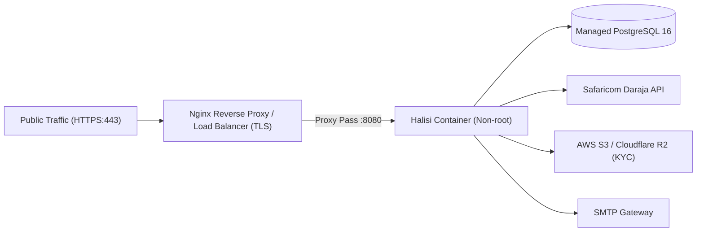

# Halisi Production Deployment & Operations Guide

## 1. Overview & Architecture

Halisi is packaged as a single, hardened, statically compiled Go binary with embedded or containerized assets. It connects to a managed **PostgreSQL 16** cluster and integrates with **Safaricom Daraja** (M-Pesa), **Google Maps**, and **Cloud Object Storage** (AWS S3 / Cloudflare R2).



---

## 2. Hardened Multi-Stage Docker Build

Halisi utilizes a two-stage build process to ensure that build tools (Go compiler, templ CLI) are excluded from the final production runtime container:

```dockerfile
# Stage 1: Build & Code Generation
FROM golang:1.26-alpine AS builder

RUN apk add --no-cache git ca-certificates tzdata

# Install templ CLI
RUN go install github.com/a-h/templ/cmd/templ@latest

WORKDIR /build

COPY go.mod go.sum ./
RUN go mod download

COPY . .

# Generate templ components and compile binary
RUN templ generate
RUN CGO_ENABLED=0 GOOS=linux GOARCH=amd64 go build \
    -ldflags="-w -s" \
    -o /build/halisi-server ./cmd/api

# Stage 2: Minimal Non-Root Runtime
FROM alpine:3.19

RUN apk add --no-cache ca-certificates tzdata

# Create unprivileged service user
RUN addgroup -S appgroup && adduser -S appuser -G appgroup

WORKDIR /app

COPY --from=builder /build/halisi-server /app/halisi-server
COPY --from=builder /build/web/static /app/web/static

USER appuser:appgroup

EXPOSE 8080

HEALTHCHECK --interval=15s --timeout=3s --retries=3 \
  CMD wget --no-verbose --tries=1 --spider http://localhost:8080/healthz || exit 1

CMD ["/app/halisi-server"]
```

---

## 3. Production Docker Compose Stack

For single-node VPS hosting (e.g. DigitalOcean, Linode, AWS EC2, Hetzner):

```yaml
version: '3.8'

services:
  app:
    build:
      context: .
      dockerfile: Dockerfile
    restart: always
    env_file: .env.production
    ports:
      - "127.0.0.1:8080:8080"
    depends_on:
      postgres:
        condition: service_healthy
    networks:
      - halisi_net

  postgres:
    image: postgres:16-alpine
    restart: always
    environment:
      POSTGRES_DB: halisi_prod
      POSTGRES_USER: ${DB_USER}
      POSTGRES_PASSWORD: ${DB_PASSWORD}
    volumes:
      - postgres_data:/var/lib/postgresql/data
    healthcheck:
      test: ["CMD-SHELL", "pg_isready -U ${DB_USER} -d halisi_prod"]
      interval: 10s
      timeout: 5s
      retries: 5
    networks:
      - halisi_net

volumes:
  postgres_data:

networks:
  halisi_net:
    driver: bridge
```

---

## 4. Nginx Reverse Proxy & TLS Configuration

Place this configuration in `/etc/nginx/sites-available/halisi`:

```nginx
server {
    listen 80;
    server_name halisi.co.ke www.halisi.co.ke;
    return 301 https://$host$request_uri;
}

server {
    listen 443 ssl http2;
    server_name halisi.co.ke www.halisi.co.ke;

    ssl_certificate /etc/letsencrypt/live/halisi.co.ke/fullchain.pem;
    ssl_certificate_key /etc/letsencrypt/live/halisi.co.ke/privkey.pem;
    ssl_protocols TLSv1.2 TLSv1.3;
    ssl_ciphers HIGH:!aNULL:!MD5;

    # Security Headers
    add_header X-Frame-Options "DENY" always;
    add_header X-Content-Type-Options "nosniff" always;
    add_header Referrer-Policy "strict-origin-when-cross-origin" always;
    add_header Strict-Transport-Security "max-age=63072000; includeSubDomains; preload" always;

    # Static Assets Caching
    location /static/ {
        proxy_pass http://127.0.0.1:8080/static/;
        proxy_set_header Host $host;
        expires 30d;
        add_header Cache-Control "public, no-transform";
    }

    # Application Proxy
    location / {
        proxy_pass http://127.0.0.1:8080;
        proxy_http_version 1.1;
        proxy_set_header Upgrade $http_upgrade;
        proxy_set_header Connection "upgrade";
        proxy_set_header Host $host;
        proxy_set_header X-Real-IP $remote_addr;
        proxy_set_header X-Forwarded-For $proxy_add_x_forwarded_for;
        proxy_set_header X-Forwarded-Proto $scheme;
        proxy_connect_timeout 60s;
        proxy_read_timeout 60s;
    }
}
```

---

## 5. Automated Database Backups

Create `/usr/local/bin/backup-halisi-db.sh`:

```bash
#!/usr/bin/env bash
set -euo pipefail

BACKUP_DIR="/var/backups/halisi"
TIMESTAMP=$(date +"%Y%m%d_%H%M%S")
FILENAME="halisi_prod_${TIMESTAMP}.sql.gz"
S3_BUCKET="s3://halisi-db-backups"

mkdir -p "${BACKUP_DIR}"

# Run pg_dump through gzip
docker exec -t halisi-postgres-1 pg_dump -U postgres halisi_prod | gzip > "${BACKUP_DIR}/${FILENAME}"

# Sync to offsite cloud storage (AWS CLI or Rclone)
aws s3 cp "${BACKUP_DIR}/${FILENAME}" "${S3_BUCKET}/${FILENAME}"

# Remove local backups older than 7 days
find "${BACKUP_DIR}" -type f -mtime +7 -delete

echo "Backup ${FILENAME} completed successfully and uploaded to offsite storage."
```

Schedule in crontab to run daily at 02:00 AM:
```cron
0 2 * * * /usr/local/bin/backup-halisi-db.sh >> /var/log/halisi-backup.log 2>&1
```

---

## 6. Health Checks & Zero-Downtime Probing

* **Liveness (`/healthz`)**: Checks that the HTTP server process is running and responding.
* **Readiness (`/readyz`)**: Validates active PostgreSQL ping and connectivity to upstream payment services before routing production traffic.

Cloud platforms should use `/readyz` for rolling deployment readiness gates to guarantee zero downtime.
